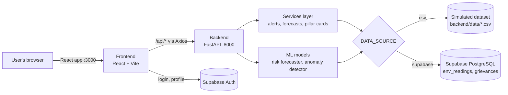
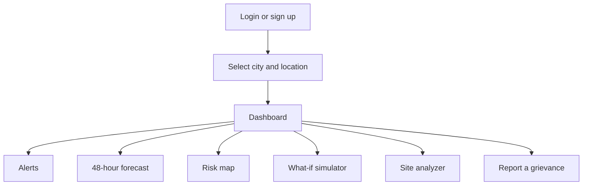
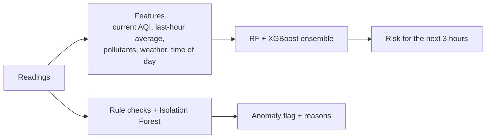

# 🌍 EnviroWatch AI

**An environmental monitoring and decision-support platform for Pune and Mumbai.**

EnviroWatch AI brings air, water, noise, emissions, waste, urban heat and groundwater data together in one dashboard. It raises alerts when safe limits are crossed, forecasts risk with machine learning, lets planners test "what if" scenarios, and checks whether a site is environmentally suitable for a hospital, school, factory or other building.

> **Data note:** the dataset is **simulated**: 10,000 readings from 20 locations (10 in each city) over one day (17 Feb 2026), with 70 parameters per reading. Model scores show that the pipeline works; they are not real-world accuracy figures.

---

## 🎯 What problem it solves

Environmental data in Indian cities is spread across agencies (CPCB, MPCB, municipal bodies) and is hard for citizens and planners to act on. EnviroWatch AI:

- shows the **current state** of 7 environmental "pillars" for any monitored location,
- **warns** when a reading breaches a safe limit and names the responsible authority,
- **predicts** what happens next (48-hour pillar forecast and a 3-hour ML risk forecast),
- **explains impact** before decisions are made (what-if simulator, site suitability), and
- lets **citizens report** problems and track them.

---

## ✨ Features

| Feature | What it does |
|---|---|
| **Dashboard** | AQI plus 7 pillar cards (air, water, noise, emissions, waste, urban heat, groundwater), AI insights and prioritised recommendations |
| **AI Risk Forecast** | Random Forest + XGBoost ensemble predicting the average risk level for the **next 3 hours**; hazardous air is always forecast Critical |
| **Anomaly detection** | Physical-limit and range checks plus an Isolation Forest, to catch faulty sensor readings |
| **Alerts** | Every threshold breach, with severity and the responsible authority (CPCB, MPCB, PMC/BMC…) |
| **48-hour forecast** | Per-pillar forecast chart with breach hours and peak time |
| **Risk map** | Current AQI risk for every location in the selected city |
| **What-if simulator** | Change traffic, industry, wind, rainfall, festival activity or green cover and see the effect on all 7 pillars |
| **Site analyzer** | Scores 12 building types (hospital, school, factory, old-age home…) for a location, lists violations, suggests better locations and estimates buildable area (FSI/TDR) |
| **Grievances** | Citizens report an issue and get a tracking ID |
| **Accounts** | Supabase sign-up and login, profile, password change and reset, plus demo accounts |

---

## 🔄 How it works

### Architecture



- The **frontend** is a single-page React app. Every API call goes through one Axios client (`frontend/src/services/api.js`).
- The **backend** loads all readings once at startup, either from the CSV or from Supabase (`DATA_SOURCE` in `backend/.env`), and keeps them in memory.
- Each request picks a reading for the chosen location to simulate a live sensor feed, then computes pillar status, alerts, forecasts or model predictions from it.

### User flow



1. **Log in** with a Supabase account, or any `@demo.com` email.
2. **Choose a city** (Pune or Mumbai) and one of its 10 locations.
3. The **dashboard** shows AQI, the 7 pillars, AI insights and the ML risk forecast.
4. From the sidebar, open alerts, the forecast, the map, the simulator, the site analyzer or the grievance form.

### Machine learning flow



- **Risk forecaster:** trained to predict the average risk class over the next 3 hours. It's evaluated on the latest 25% of the day, never on random rows (neighbouring readings are nearly identical). It reaches 91% balanced accuracy against 80% for a "same as last hour" baseline, and catches 98% of upcoming high-risk periods.
- **Anomaly detector:** first rejects physically impossible values (such as pH outside 0–14), then uses an Isolation Forest for unusual combinations of values.
- Train with `python scripts/train_all_models.py`. Model files are not stored in git.

---

## 🧰 Requirements

| Need | Version / notes |
|---|---|
| Python | 3.10 or newer |
| Node.js | 20 or newer (needed by React Router 7) |
| Supabase project | Free tier is enough. Required for real accounts; optional for data (the CSV works offline) |
| Disk | About 1.5 GB for the Python virtual environment and node modules |

### Environment variables

Copy the examples and fill them in. Never commit the real `.env` files.

| File | Variable | Purpose |
|---|---|---|
| `backend/.env` | `SECRET_KEY` | Signs demo-login tokens (any long random string) |
| | `SUPABASE_URL`, `SUPABASE_ANON_KEY`, `SUPABASE_SERVICE_ROLE_KEY` | Supabase → Project Settings → API |
| | `DATABASE_URL` | Supabase → Project Settings → Database (only for `migrate_and_seed.py`) |
| | `ALLOWED_ORIGINS` | Frontend URL(s) allowed by CORS, default `http://localhost:3000` |
| | `DATA_SOURCE` | `csv` (default) or `supabase` |
| `frontend/.env` | `VITE_SUPABASE_URL`, `VITE_SUPABASE_ANON_KEY` | Same project as the backend |
| | `VITE_API_BASE_URL` | Backend URL, default `http://localhost:8000` |

---

## 🚀 Getting started

### 1. Backend
```bash
cd backend
python3 -m venv venv
source venv/bin/activate              # Windows: venv\Scripts\activate
pip install -r requirements.txt
cp .env.example .env                  # then fill in your keys
python scripts/train_all_models.py    # once, about 1 minute
uvicorn app.main:app --reload
```

### 2. Frontend (in a second terminal)
```bash
cd frontend
npm install
cp .env.example .env                  # then fill in your keys
npm run dev
```

Open **http://localhost:3000**. Interactive API docs are at **http://localhost:8000/docs**.

### 3. Database (optional)
By default the backend reads the bundled CSV. To serve data from Supabase:
1. Run `scripts/supabase_schema.sql` in the Supabase SQL Editor.
2. `cd backend && python scripts/migrate_and_seed.py` adds the remaining columns and uploads the 10,000 readings. It won't overwrite existing data unless you pass `--replace`.
3. Set `DATA_SOURCE=supabase` in `backend/.env`. Grievances are then stored in the database too.

Startup then takes 10–30 seconds while readings load. If the database can't be reached, the backend falls back to the CSV.

For password-reset emails, add `http://localhost:3000/reset-password` under **Supabase → Authentication → URL Configuration → Redirect URLs**.

### Demo login
Any email ending in **`@demo.com`** with any password, for example `demo@demo.com`. Demo accounts don't use Supabase; their profile is saved in the browser.

---

## 🧪 Tests and lint

```bash
cd backend && pytest        # 25 tests; always uses the CSV, never the database
cd frontend && npm run lint
```

---

## 📁 Project structure

```
├── backend/
│   ├── app/
│   │   ├── api/routes/      # API endpoints, one file per feature
│   │   ├── core/            # Settings loaded from .env
│   │   ├── db/              # Supabase client and env_readings loader
│   │   ├── ml/              # Risk forecaster, anomaly detector, feature engineering
│   │   ├── schemas/         # Request/response models
│   │   └── services/        # Data loading, pillar cards, alerts, 48-hour forecast
│   ├── data/                # Simulated dataset (CSV)
│   ├── scripts/             # train_all_models.py, migrate_and_seed.py
│   └── tests/
├── frontend/src/
│   ├── components/          # Layout (sidebar, header), ErrorBoundary
│   ├── pages/               # One file per screen
│   ├── services/            # API client, Supabase client
│   └── store/               # App state (city, location, user)
├── scripts/                 # SQL schema and migrations
├── poster/                  # Project poster
└── docs/API.md              # API reference
```

---

## 🔧 Main API endpoints

| Method | Endpoint | Purpose |
|---|---|---|
| POST | `/api/auth/login`, `/api/auth/register` | Authentication |
| GET | `/api/locations/list` | Cities and locations |
| GET | `/api/dashboard/summary`, `/ai-insights`, `/city-overview` | Dashboard data |
| GET | `/api/alerts/active` | Active alerts |
| GET | `/api/forecast/48hr/{location}` | 48-hour forecast |
| GET | `/api/ml/predict-risk`, `/detect-anomaly`, `/model-info` | Machine learning |
| POST | `/api/simulation/predict-impact` | What-if simulation |
| GET | `/api/site-analysis/analyze`, `/construction-types` | Site suitability |
| POST / GET | `/api/grievance/submit`, `/status/{tracking_id}` | Grievances |

Full reference: [`docs/API.md`](docs/API.md).

---

## 🛠️ Troubleshooting

| Problem | Fix |
|---|---|
| `address already in use` on port 8000 | Another backend is running: `pkill -f "uvicorn app.main:app"` |
| ML card missing / `/api/ml/*` returns 503 | Train the models: `cd backend && python scripts/train_all_models.py` |
| Backend slow to start | Normal in database mode (loading 10,000 readings); wait for "Loaded 10000 readings" |
| VS Code shows "Import could not be resolved" | Select the interpreter `backend/venv/bin/python` |
| Sign-up fails with "Too many attempts" | Supabase rate limit; wait a minute or use a `@demo.com` account |

---

## ⚠️ Limitations

- The data is simulated and covers a single day, so forecasts and scores are illustrative.
- "Live" readings are sampled from the dataset rather than streamed from sensors.
- Alerts are computed on request, not stored, so acknowledging one doesn't persist across reloads.

## 📚 More documentation

- [`PROJECT_SUMMARY.md`](PROJECT_SUMMARY.md): architecture and ML details
- [`EXPLANATION.md`](EXPLANATION.md): step-by-step request walkthrough
- [`docs/API.md`](docs/API.md): every endpoint with examples
